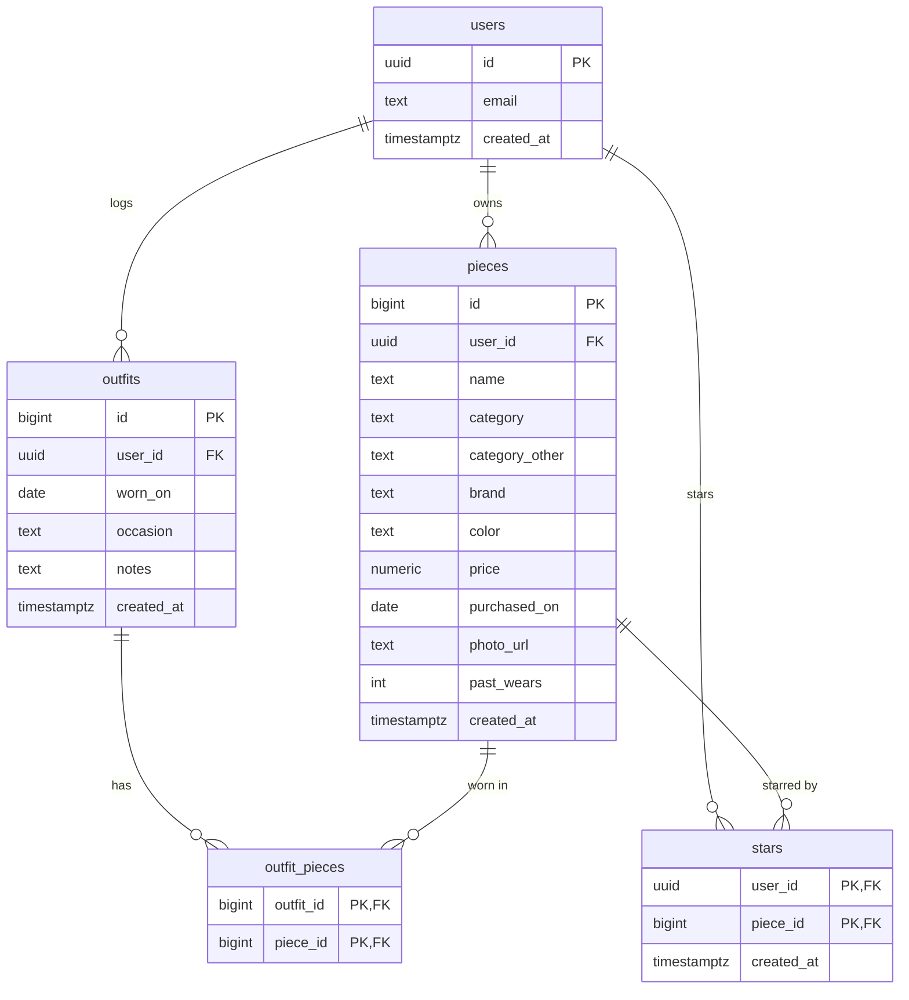

# Database schema

Closet Log has **5 tables** in Supabase (Postgres), plus one storage bucket for photos. The SQL for each lives in `supabase/migrations/`.

## Diagram

## Tables

### users
One row per account. Supabase Auth handles the actual login; a trigger copies every new sign-up into this table.

| Column | Type | Notes |
|---|---|---|
| id | uuid | **Primary key.** Same id as the Supabase Auth account |
| email | text | Required |
| created_at | timestamp | When they signed up |

### pieces (my main item)
One row per piece of clothing.

| Column | Type | Notes |
|---|---|---|
| id | number (auto) | **Primary key** |
| user_id | uuid | **→ users.** Who owns it. Filled in automatically |
| name | text | Required |
| category | text | Required. One of: top, bottom, dress, jumpsuit, romper, outerwear, shoes, bag, accessory, other |
| category_other | text | Only when category is "other": what the piece is (e.g. "Swimsuit"). Required then, up to 40 characters |
| brand | text | Optional |
| color | text | Optional |
| price | number (2 decimals) | Optional |
| purchased_on | date | Optional |
| photo_url | text | Optional. Link to the photo in the `photos` bucket |
| past_wears | whole number | Times worn before I started logging outfits. Defaults to 0 |
| created_at | timestamp | When it was added |

### outfits
One row per day I wore something.

| Column | Type | Notes |
|---|---|---|
| id | number (auto) | **Primary key** |
| user_id | uuid | **→ users** |
| worn_on | date | Required. Can't be in the future |
| occasion | text | Optional |
| notes | text | Optional |
| created_at | timestamp | |

### outfit_pieces (junction table)
Connects outfits and pieces. One row = "this piece was in this outfit."

| Column | Type | Notes |
|---|---|---|
| outfit_id | number | **→ outfits** |
| piece_id | number | **→ pieces** |

**Primary key** is the pair (outfit_id, piece_id), so a piece can't be added to the same outfit twice.

### stars (junction table)
One table for everyone. One row = "this user starred this piece."

| Column | Type | Notes |
|---|---|---|
| user_id | uuid | **→ users** |
| piece_id | number | **→ pieces** |
| created_at | timestamp | When it was starred |

**Primary key** is the pair (user_id, piece_id), so a piece can't be starred twice.

## How they connect

- **users → pieces:** one-to-many. A user owns many pieces.
- **users → outfits:** one-to-many. A user logs many outfits.
- **outfits ↔ pieces:** many-to-many, through **outfit_pieces**. One outfit has several pieces; one piece shows up in many outfits. This is how wear counts and cost-per-wear are worked out.
- **users ↔ pieces (stars):** many-to-many, through **stars**.
- Deleting a user deletes everything of theirs. Deleting a piece removes it from outfits and stars. Deleting an outfit keeps the pieces.

**Wears** = `past_wears` + the number of rows in outfit_pieces for that piece.
**Cost-per-wear** isn't stored. It's calculated as price ÷ wears.

## Privacy (row-level security)

Every table has row-level security turned on. The rule is the same everywhere: you can only see or change rows where `user_id` is you. For the junction tables, you can only link outfits and pieces you own. The data isolation test (`tests/isolation.test.ts`) checks this against the real database.

## Photos (storage, not a table)

Photos live in a Supabase Storage bucket called `photos`. Each user uploads into their own folder (`photos/<user id>/…`) and can only add or delete files there. Only JPG, PNG, and WebP up to 5 MB.

## Plan vs. what got built

Compared with section 3 of PLAN.md, the agent built the **same 5 tables, same columns, same relationships**. Differences are only in the details:

| In my plan | What got built | Why |
|---|---|---|
| users.id is **text** | **uuid** | Supabase Auth ids are uuids, so the users table has to match |
| pieces/outfits id is "number" | **bigint, auto-numbered** | Postgres picks the next number itself |
| created_at is **date** | **timestamp** (date + time) | Needed to sort "newest first" within the same day |
| price is "number" | **numeric(10,2)** | Money with exactly 2 decimals, so no rounding surprises |
| Category is free text, 7 options | Still text, now 10 options, plus **category_other** for "Other" | Added jumpsuit, romper, and other later, after realizing some pieces didn't fit |
| Not in plan | **past_wears** on pieces | My closet existed before the app did; logged outfits alone made old favorites look unworn |
| Not in plan | **Trigger** that copies sign-ups into users | So every account is a row in my own users table automatically |
| Not in plan | **Row-level security** rules on every table | My plan said "each user sees only their own rows"; these rules are how |
